# Awesome-UI-Design-Systems-Glassmorphism-Components 💎✨

  

  
  
  
  
  
  

---

## 🧭 Executive Summary & SEO Guide

Welcome to the definitive collection of **UI Design Systems**, **Glassmorphism Component Libraries**, **Liquid Glass Shaders**, and **Enterprise Design Token Frameworks**. Whether you are building next-generation SaaS dashboards with frosted-glass (`backdrop-filter: blur()`) aesthetics, architecting accessible WAI-ARIA compliant frontend components, or synchronizing Figma design tokens across React, Vue, Svelte, and SolidJS applications, this curated guide benchmarks the entire commercial and open-source landscape.

### 🌟 Key Focus Areas
- 🪟 **Frosted Glass & Liquid Glass UI Kits:** Translucent glassmorphism, real-time WebGL/WebGPU refractive shaders, chromatic aberration, and specular edge highlights.
- 🧱 **Accessible Headless Primitives:** WAI-ARIA compliant components powered by Radix UI, Base UI, React Aria, and Zag.js/Ark UI.
- 🎨 **Utility-First & Copy-Paste Component Systems:** Zero-dependency, themeable component copy workflows via shadcn/ui, Tailwind CSS, DaisyUI, and Flowbite.
- 📐 **Design Tokens & System Architecture:** W3C design token pipelines using Style Dictionary, Figma Variables, Supernova, and Zeroheight.

---

## 📑 Table of Contents
- [Sector Overview & Market Dynamics](#-sector-overview--market-dynamics)
- [SaaS & Commercial Platforms](#-saas--commercial-platforms)
- [Open-Source GitHub Projects](#-open-source-github-projects)
- [Star History](#-star-history)
- [Support & Community](#-support--community)
- [How to Contribute](#-how-to-contribute)
- [License & Disclaimer](#-license--disclaimer)

---

## 📊 Sector Overview & Market Dynamics

> The global **UI/UX Design Software & Design Systems** market is estimated at **$2.6B to $3.2B**, expanding rapidly at an estimated **CAGR of 15% to 22.25%** through 2030, driven by cross-platform design token synchronization, headless accessibility primitives, and generative AI component synthesis. The sector is **highly fragmented** across 120+ specialized toolchains (with over 44% of product engineering teams juggling 3+ disparate design token, prototyping, and code generation tools simultaneously), preventing any single winner-take-all monopoly and creating immense room for open-source copy-paste primitives and specialized glassmorphic UI kits.

---

## 💼 SaaS & Commercial Platforms

The table below benchmarks commercial design system platforms, hosted generative UI workspaces, and premium component ecosystems. Entries are ranked in descending order by **Company Scale (Valuation / Revenue / Parent Scale)**.

| 🏢 Platform | 💰 Pricing (Starting Tier) | 🎁 Free Tier Limit / Trial | 📈 Company Scale (Valuation / Revenue) | 🔍 Key Capabilities |
| :--- | :--- | :--- | :--- | :--- |
| **[v0 by Vercel](https://v0.dev)** | **$20/mo** (Vercel Pro) / **$30/user/mo** (v0 Plus) | **$0/mo Free Forever**: Includes **$5 monthly generation credits** with a **7 messages/day** cap, public app deployments, and GitHub sync. | **$9.3B Valuation** (~$340M–$500M+ ARR; backed by Accel, GIC) | Generative UI cloud environment synthesizing custom shadcn/ui, Tailwind CSS, and frosted-glass React interfaces from natural language prompts. |
| **[Tailwind Plus](https://tailwindcss.com)** *(formerly Tailwind UI)* | **$299** one-time purchase (Personal lifetime license) | **Free Forever (Preview Only)**: Full framework (`tailwindcss`) is MIT-licensed; component library offers interactive live demos and 3 preview templates without code export. | **Acquired by Shopify ($130B+ Market Cap)** (Peak bootstrapped revenue was ~$3M–$8M ARR before Shopify acquisition) | Official production library of 500+ responsive marketing blocks, application shells, and e-commerce templates built by Tailwind Labs. |
| **[Zeroheight](https://zeroheight.com)** | **$49/editor/mo** billed annually ($59/mo monthly) | **$0/mo Free Forever**: Restricted to **1 editor, 1 styleguide, and 1 design token set** with standard Figma/Storybook sync. | **~$50M–$100M Est. Valuation** (~$10M–$25M ARR; $10M Series A led by Tribe Capital with Adobe & YC) | Cloud-native design system documentation portal connecting Figma libraries, Storybook sandboxes, and tokens into branded design portals. |
| **[Supernova.io](https://supernova.io)** | **$35/user/mo** billed annually (Pro Tier) | **$0/mo Free Forever**: Up to **3 team editors, 1 design system source, 20 documentation pages**, and 1,000 automation credits/mo. | **~$35M–$60M Est. Valuation** (~$5M ARR; $14M+ total funding from Wing VC, EQT, Taiwania Capital) | End-to-end design token management and code generation automation platform syncing Figma variables to React, iOS Swift, and Android XML. |
| **[Relume](https://relume.io)** | **$12/site/mo** (Launch) / **$18/user/mo** (Pro billed annually) | **$0/mo Free Forever**: **1 project**, 1 small site/wireframe generation test, 30 free Webflow/Figma components, and 1,500 pageviews/mo on relumesite.ai subdomain. | **~$30M–$50M Est. Valuation** (~$3.3M–$14M ARR; Bootstrapped & highly profitable, backed by product-led growth) | AI-powered site architect and wireframe system with 1,000+ customizable component primitives exportable to Figma, Webflow, and React. |
| **[Material UI Store & MUI X Pro](https://mui.com)** | **$299/year per dev** (MUI X Pro) / Individual templates from **$49–$199** | **$0/mo Free Forever**: Core Material UI / Base UI / Joy UI components are MIT-licensed. Community MUI X includes foundational Data Grid & Date Pickers (advanced grouping/pinning/Excel exports gated). | **~$20M–$40M Est. Valuation** (~$4M–$8M ARR; Bootstrapped and community/enterprise dual-licensed) | Enterprise data grids, date/time range pickers, visual chart suites, and commercial dashboard application kits for enterprise React systems. |
| **[Flowbite Pro](https://flowbite.com)** | **$169** one-time (Figma Designer) / **$299** one-time (Developer Full Access) | **$0/mo Free Forever**: Open-source core provides **600+ Tailwind CSS components** under MIT license. Excludes pro application dashboards, e-commerce sections, and Figma files. | **~$10M–$20M Est. Valuation** (~$2M–$5M ARR; Bootstrapped by Themesberg / Crafty Dwarf LLC) | Comprehensive Tailwind CSS UI kit and Figma library containing 400+ advanced application templates, dark-mode dashboards, and glassmorphic layouts. |
| **[Ant Design System for Figma](https://antforfigma.com)** | **$149** one-time (Starter Bundle) / **$299** (Pro Bundle) | **Free Demo / Community Edition**: Provides an introductory subset of basic Ant Design tokens and core button/input variants; lacks nested dashboards and pro page templates. | **~$5M–$10M Est. Valuation** (~$1M–$2M ARR; Bootstrapped independent ecosystem company) | The leading commercial Figma design system faithfully mapping Ant Design React tokens, components, and responsive enterprise patterns for designers. |
| **[HeroUI Pro](https://heroui.pro)** *(formerly NextUI Pro)* | **$299** one-time purchase (Lifetime component access + 1 year updates) | **Free Forever (Core Open-Source)**: Core HeroUI and HeroUI Native are 100% free under Apache 2.0 (40+ primitives). Pro templates and AI skills require commercial purchase. | **~$3M–$8M Est. Valuation** (~$500K–$1.5M ARR; Independent open-core startup) | Premium glassmorphic application layouts, AI chat interfaces, and e-commerce templates built on Tailwind CSS, React Aria, and Framer Motion. |
| **[Chakra UI Pro](https://chakra-ui.com)** | **$299** one-time purchase (Personal) / **$899** (Team license) | **Free Forever (Core Open-Source)**: Core Chakra UI library is 100% free under MIT. Pro blocks have zero free tier and can only be evaluated via online documentation previews. | **~$3M–$6M Est. Valuation** (~$500K–$1M ARR; Independent open-core ecosystem by Chakra Systems) | Commercial production suite of multi-theme marketing components, application shells, and e-commerce layouts built on Chakra UI with Figma dark-mode parity. |

---

## 🔓 Open-Source GitHub Projects

Below is a curated index of top open-source design systems, glassmorphism shader engines, headless primitives, and UI component toolkits. Repositories are dynamically ranked in **descending order by GitHub stargazers count**, with official social badges linking directly to each project's stargazers page.

| 📦 Repository & Framework | ⭐ Stargazers Count | 🏷️ License | 📝 Architecture & Glassmorphic Highlights |
| :--- | :--- | :--- | :--- |
| **[twbs/bootstrap](https://github.com/twbs/bootstrap)** |  | `MIT` | The world's most famous HTML, CSS, and JS framework with responsive grid architecture, CSS custom properties, and customizable surface blur utilities. |
| **[shadcn-ui/ui](https://github.com/shadcn-ui/ui)** |  | `MIT` | Revolutionized frontend architecture via copy-paste component code built on Radix UI primitives and Tailwind CSS. The standard foundation for translucent modern web apps. |
| **[ant-design/ant-design](https://github.com/ant-design/ant-design)** |  | `MIT` | Enterprise-class design language and high-density React UI library featuring dynamic CSS-in-JS design tokens and comprehensive dashboard analytics components. |
| **[mui/material-ui](https://github.com/mui/material-ui)** |  | `MIT` | Production-grade React UI library implementing Material Design with CSS theme variables, slot-based architecture, and accessible form/overlay primitives. |
| **[tailwindlabs/tailwindcss](https://github.com/tailwindlabs/tailwindcss)** |  | `MIT` | Utility-first CSS engine delivering native `backdrop-blur-*`, `backdrop-saturate-*`, translucent color mixing, and custom glass tokens for responsive web applications. |
| **[storybookjs/storybook](https://github.com/storybookjs/storybook)** |  | `MIT` | The industry-standard frontend workshop for building, testing, documenting, and visually validating design system components and theme variants in isolation. |
| **[saadeghi/daisyui](https://github.com/saadeghi/daisyui)** |  | `MIT` | Extremely popular semantic component class plugin for Tailwind CSS featuring 55+ UI components, multiple built-in color themes, and a native `.glass` translucent styling modifier. |
| **[tabler/tabler](https://github.com/tabler/tabler)** |  | `MIT` | Free, open-source dashboard template and component library with clean responsive layouts, modern card structures, and polished dark/frosted interface modes. |
| **[vuetifyjs/vuetify](https://github.com/vuetifyjs/vuetify)** |  | `MIT` | Complete Material Design component framework for Vue 3 with responsive layouts, comprehensive accessibility support, and dynamic theme surface tokens. |
| **[chakra-ui/chakra-ui](https://github.com/chakra-ui/chakra-ui)** |  | `MIT` | Simple, modular, and accessible component library for React with intuitive style props, ergonomic design token pipelines, and comprehensive dark-mode support. |
| **[mantinedev/mantine](https://github.com/mantinedev/mantine)** |  | `MIT` | Full-featured React component and hooks library providing 100+ accessible components, frosted `Overlay` primitives, notification systems, and form management. |
| **[heroui-inc/heroui](https://github.com/heroui-inc/heroui)** |  | `Apache-2.0` | Formerly NextUI. Modern React UI library built on Tailwind CSS and React Aria with native `isBlurred` frosted-glass navigation bars, popovers, and spring animations. |
| **[tailwindlabs/headlessui](https://github.com/tailwindlabs/headlessui)** |  | `MIT` | Unstyled, fully accessible UI components for React and Vue, engineered to integrate seamlessly with Tailwind CSS utility classes and custom translucent backdrops. |
| **[quasarframework/quasar](https://github.com/quasarframework/quasar)** |  | `MIT` | Cross-platform Vue.js framework enabling developers to generate responsive SPA, PWA, SSR, mobile, and desktop apps from a single component-driven codebase. |
| **[lucide-icons/lucide](https://github.com/lucide-icons/lucide)** |  | `ISC` | Clean, lightweight, and customizable SVG icon system (1,500+ icons) designed with pixel-perfect consistency for modern flat and glassmorphic user interfaces. |
| **[magicuidesign/magicui](https://github.com/magicuidesign/magicui)** |  | `MIT` | Library of 50+ animated landing page components, frosted-glass bento grids, border beam highlights, and interactive micro-interactions built with Tailwind and Motion. |
| **[radix-ui/primitives](https://github.com/radix-ui/primitives)** |  | `MIT` | Unstyled, accessible React component primitives with robust WAI-ARIA compliance, keyboard navigation, and focus management for building custom design systems. |
| **[adobe/react-spectrum](https://github.com/adobe/react-spectrum)** |  | `Apache-2.0` | Adobe's collection of accessible UI libraries (including React Aria and React Stately) delivering unstyled hooks, internationalization, and robust focus routines. |
| **[mui/base-ui](https://github.com/mui/base-ui)** |  | `MIT` | Headless, unstyled UI component primitives engineered by the MUI team for maximum styling flexibility, micro-animation fidelity, and zero CSS opinion. |
| **[carbon-design-system/carbon](https://github.com/carbon-design-system/carbon)** |  | `Apache-2.0` | IBM’s open-source design system for products and digital experiences, featuring comprehensive accessibility standards, data visualization palettes, and token guidelines. |
| **[themesberg/flowbite](https://github.com/themesberg/flowbite)** |  | `MIT` | Open-source ecosystem of 600+ interactive UI components built on Tailwind CSS with native dark mode, RTL layouts, and adapters for React, Vue, Svelte, and Angular. |
| **[huntabyte/shadcn-svelte](https://github.com/huntabyte/shadcn-svelte)** |  | `MIT` | Official Svelte port of shadcn/ui built on Bits UI and Tailwind CSS, bringing modular copy-paste components and design tokens to the Svelte ecosystem. |
| **[ariakit/ariakit](https://github.com/ariakit/ariakit)** |  | `MIT` | Open-source library of unstyled, accessible React components and composable primitives adhering strictly to WAI-ARIA authoring practices. |
| **[primefaces/primereact](https://github.com/primefaces/primereact)** |  | `MIT` | Rich suite of over 90 React components with an unstyled Tailwind mode, enterprise data tables, tree views, and customizable theme skins. |
| **[ibelick/motion-primitives](https://github.com/ibelick/motion-primitives)** |  | `MIT` | Beautiful, composable motion UI primitives built with Framer Motion and Tailwind CSS for creating smooth, fluid, high-craft web interactions. |
| **[rdev/liquid-glass-react](https://github.com/rdev/liquid-glass-react)** |  | `MIT` | Apple-inspired Liquid Glass component suite for React featuring SVG displacement map refraction, chromatic aberration, and dynamic specular highlights. |
| **[skeletonlabs/skeleton](https://github.com/skeletonlabs/skeleton)** |  | `MIT` | Adaptive design system and UI toolkit for Svelte and Tailwind CSS offering frosted surfaces, token-driven palettes, and integrated accessibility. |
| **[chakra-ui/ark](https://github.com/chakra-ui/ark)** |  | `MIT` | Headless, accessible component library powered by Zag.js state machines providing unified primitives across React, Solid, Vue, and Svelte. |
| **[amzn/style-dictionary](https://github.com/amzn/style-dictionary)** |  | `Apache-2.0` | Amazon's build system for design tokens that translates cross-platform JSON tokens into CSS variables, SCSS maps, Tailwind presets, iOS Swift, and Android XML. |
| **[primer/react](https://github.com/primer/react)** |  | `MIT` | GitHub's official open-source design system implementing Primer guidelines with accessible React components, typography primitives, and color tokens. |
| **[tremorlabs/tremor](https://github.com/tremorlabs/tremor)** |  | `Apache-2.0` | Modular React library of 35+ analytics cards, KPI callouts, and chart components built on Tailwind CSS and Radix UI for modern dashboards. |
| **[cschroeter/park-ui](https://github.com/cschroeter/park-ui)** |  | `MIT` | Multi-framework copy-paste component system built on Ark UI primitives and Panda CSS / Tailwind CSS with semantic design tokens. |
| **[deeplethe/solid-glass](https://github.com/deeplethe/solid-glass)** |  | `MIT` | Specialized SolidJS library delivering realistic Liquid Glass effects, frosted translucent cards, specular lighting reflections, and optical depth shaders. |
| **[kobaltedev/kobalte](https://github.com/kobaltedev/kobalte)** |  | `MIT` | Accessible, unstyled UI toolkit for SolidJS inspired by Radix UI, adhering strictly to WAI-ARIA standards for creating custom glassmorphic components. |
| **[naughtyduk/liquidGL](https://github.com/naughtyduk/liquidGL)** |  | `MIT` | High-performance WebGL/WebGPU Liquid Glass shader library rendering fluid physics, real-time light refraction, and frosted optical distortion on the web. |
| **[sdegenaar/liquid_glass_widgets](https://github.com/sdegenaar/liquid_glass_widgets)** |  | `MIT` | Cross-platform Flutter widget library implementing Apple-style Liquid Glass UI components with custom shaders, physics-driven jelly motion, and dynamic lighting. |
| **[ybouane/liquidglass](https://github.com/ybouane/liquidglass)** |  | `MIT` | Client-side WebGL shader library applying real-time glass refraction, chromatic dispersion, and adaptive backdrop blur to standard HTML/CSS DOM elements. |

---

## 📈 Star History

---

## 💖 Support & Community

If you find this curated ecosystem directory helpful in selecting design systems, evaluating glassmorphism libraries, or architecting frontend applications:

- 🌟 **Star this repository** to help other frontend engineers and UI/UX designers discover it!
- 🍴 **Fork and contribute** your favorite component libraries, shader experiments, or SaaS design tools.
- 📣 **Share on Socials:** Post on X/Twitter, LinkedIn, Reddit, or Discord communities.
- ☕ **Support Ongoing Curation:** You can buy me a coffee and support independent developer tooling curation directly via the [GitHub Sponsors Dashboard](https://github.com/sponsors/ishandutta2007).

---

## 🤝 How to Contribute

Contributions are welcome and highly appreciated! To submit a new design system, glassmorphism component library, or commercial platform:

1. Fork this repository.
2. Create a descriptive feature branch: `git checkout -b feature/add-new-ui-library`.
3. Add your entry in alphabetical or star-ranked order with accurate licensing and factual capability notes.
4. Verify all markdown links and badge parameters.
5. Submit a Pull Request with a brief explanation of why the tool is a notable addition to the ecosystem.

---

## ⚖️ License & Disclaimer

- Distributed under the [Creative Commons Zero v1.0 Universal (CC0 1.0)](https://creativecommons.org/publicdomain/zero/1.0/) license.
- All product names, logos, and brands are property of their respective owners. Mention in this repository is strictly for educational, informational, and indexing purposes.
